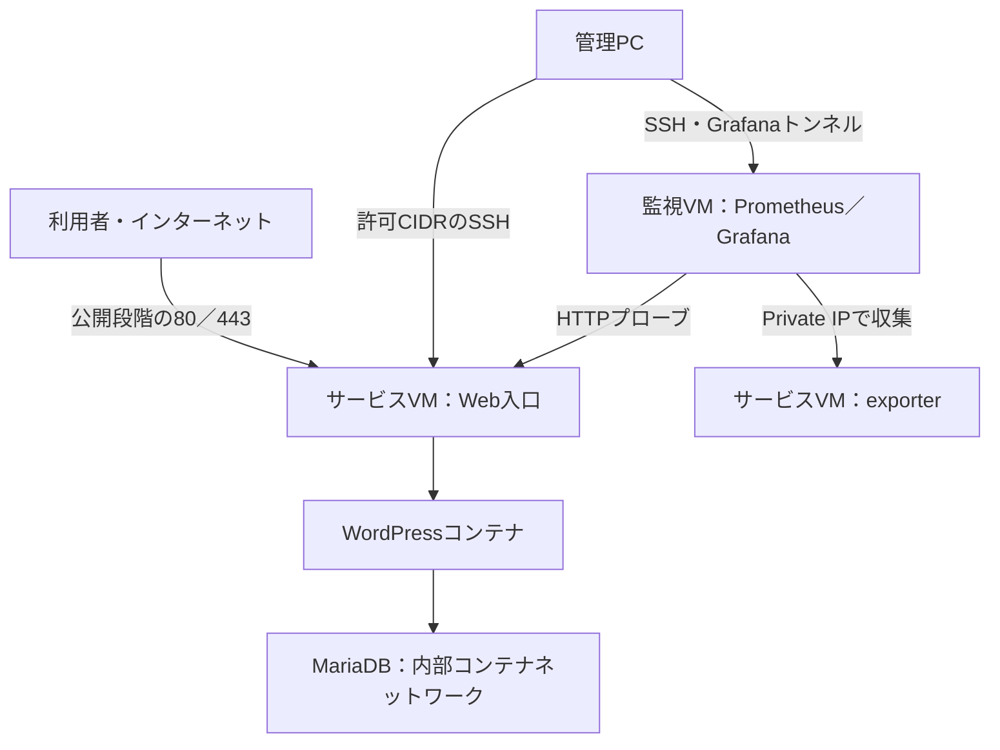

# 小さなインターネットサービスの構築・公開・監視・保護・廃止：教材設計書

- 版：1.0
- 作成日：2026-10-04
- 対象：OCI上の2台のVMとコンテナを使った社内勉強会
- 実装担当：Codex、実環境の実行・証跡取得担当：教材作成者

## 1. 目的と前提

WordPressの構築を題材に、ネットワーク、OS、アプリケーション、DB、監視、セキュリティ、運用の関係と、サービスのライフサイクルを理解する。Terraformやコンテナの構文習得そのものを主目的にしない。

当日の実機ハンズオンは環境制約により行わない。事前に構築した環境の構成図、変更差分、画面、ログを使い、受講者が「予想→変更→観測→考察」を追体験する。実測していない結果を実験結果として提示しない。

PowerPointはWhy／What／Question、GitHubはHow／実装／証跡を担当する。今回作成するのは実装設計と実装指示であり、完成スライドは別工程とする。

### 合意済みの事項

- OCIを利用し、サービスVMと監視VMの2台を構築する。
- TerraformはまずローカルPCから実行し、OCI CLIのSecurity Token認証を使う。
- 専用Compartmentと実行主体へのIAM Policyは事前準備とし、教材Terraformの外に置く。
- WordPress／MariaDB、Prometheus／Grafanaを中心に構成する。コンテナ実行基盤はPodmanを基本とする。
- 段階ごとの資材と証跡を残し、完成版だけを置かない。
- インターネット公開とアクセス観測、公開範囲の見直し、削除と残存物の確認を含める。

### 本書で補う実装方針

以下は会話で細部まで確定していないため、本書の推奨案とする。実装時の調査で変更する場合は理由をADRに残す。

- 単一VCN、単一Public Subnet、役割別NSGを使う簡潔な構成。
- 両VMにPublic IPを付けるが、監視VMの公開接続は管理元のSSHだけに限定する。GrafanaはSSHトンネルで見る。
- Linuxディストリビューション、CPUアーキテクチャ、Shape、メモリ、Boot Volume容量は互換性と実測に基づき選ぶ。無料枠の利用可能性は保証しない。
- コンテナの起動管理はsystemd／Podman Quadletを第一候補とする。OS付属Podmanの対応を確認する。
- ドメイン・DNS・公開HTTPSは任意の追加構成とする。ドメイン未提供でも初期構築と制限されたHTTP確認を可能にする。

## 2. 学習到達点

1. コードからネットワークとVMが作成されることを説明できる。
2. Public IPがあることと、サービスへ到達できることの違いを説明できる。
3. コンテナ、ホスト、ネットワークの責任境界を説明できる。
4. CPUが低いことだけではサービス正常性を判断できないと理解する。
5. 公開するポートと通信元について理由を説明できる。
6. Terraform destroyで消えるものと、別途処理するものを区別できる。

## 3. 全体構成



### リソース

| 区分 | 内容 | 管理 |
|---|---|---|
| 事前準備 | アカウント、ユーザー／グループ、専用Compartment、IAM Policy | 手動 |
| ネットワーク | VCN、Subnet、Internet Gateway、Route Table、Security List、役割別NSG | Terraform |
| 計算基盤 | サービスVM、監視VM、付随Boot Volume／VNIC／IP | Terraform |
| 初期OS設定 | 管理ユーザー、SSH公開鍵、Podman、必要パッケージ、時刻同期 | cloud-init |
| サービス設定 | コンテナ、systemdユニット、監視設定、ダッシュボード | バージョン管理資材＋適用スクリプト |
| データ | WordPress／MariaDB永続データ、監視時系列、ログ | VM上の永続領域 |
| 任意 | DNSレコード、TLS証明書 | 管理方法を別途明記 |

初期導入はcloud-initで行い、段階移行は専用の冪等なスクリプトで行う。cloud-initを変更すると既存VMが再設定されると仮定しない。Terraform apply完了とコンテナの準備完了も区別する。

## 4. 認証・認可・State

### ローカル認証

```bash
oci session authenticate --region ap-tokyo-1 --profile-name internet-service-lab
oci session validate --profile internet-service-lab --auth security_token
```

```hcl
provider "oci" {
  auth                = "SecurityToken"
  config_file_profile = var.oci_profile
  region              = var.region
}
```

公式資料ではTerraform用トークンの有効期間は1時間とされる。plan／apply／destroy前に有効性を確認する。期限切れは再認証し、有効期間内の更新はCLIの仕様に従う。[R1][R2]

Security Tokenでもローカルにセッション用秘密鍵・トークンが存在する。「秘密鍵を持たない」方式とは説明しない。長期API署名鍵をリポジトリやCIに配置しない点と、セッションが短命である点を説明する。OCI設定・セッションファイルはGitにも教材の証跡にも含めない。

### 認可

専用Compartment内にネットワーク・VM・必要なボリューム等を作成する権限を付与する。管理者アカウントのセッショントークンを使うだけでは権限は限定されない。専用実行ユーザー／グループに適切なPolicyを与える。イメージ検索やAvailability Domain等で追加のread／inspect権限が必要なら、公式仕様と実際のエラーに基づき明記する。Tenancy全体のmanage all-resourcesを教材の標準にしない。

Policyの具体的な文法・必要権限一覧は実装時に確認し、bootstrap.mdに記録する。認証成功、APIの読み取り成功、対象リソースの作成権限は別々に検証する。

### State

初期版は単独ローカル実行としてlocal backendを使う。同じ環境を操作するルートを1つにし、同時実行しない。Stateを失うとdestroyや管理の継続が難しくなるため、非公開のバックアップ手順を用意する。

State、保存plan、tfvars、秘密鍵、セッションファイル、秘密情報を含む生ログはGit管理しない。`.terraform.lock.hcl`はGit管理する。sensitive指定はStateから秘密値を除去する機能ではない。DBやGrafanaのパスワードはVM側で生成し、権限を制限したファイルからコンテナへ渡す。Terraform変数・user_data・outputsへ秘密値を流さない。

## 5. ネットワークと通信制御

例としてVCNを10.20.0.0/16、Subnetを10.20.1.0/24とする。既存環境との重複時に変更できる変数とする。IPv4を初期版の対象とし、IPv6を暗黙に有効化しない。

| 通信 | 初期／構築中 | 公開実験 | 保護後 |
|---|---|---|---|
| サービスVM SSH 22 | 管理CIDR | 管理CIDR | 管理CIDR |
| サービスVM HTTP 80 | 管理CIDR | 0.0.0.0/0 | 公開方針に応じ許可／HTTPSへ誘導 |
| サービスVM HTTPS 443 | TLS導入時に管理CIDR | TLS導入時に0.0.0.0/0 | TLS導入時に0.0.0.0/0 |
| 監視VM SSH 22 | 管理CIDR | 管理CIDR | 管理CIDR |
| Grafana 3000 | loopback＋SSHトンネル | 同左 | 同左 |
| Prometheus 9090 | loopback／内部のみ | 同左 | 同左 |
| Node exporter等 | 監視VMのPrivate IP／NSGのみ | 同左 | 同左 |
| MariaDB 3306 | 内部コンテナネットワークのみ | 同左 | 同左 |

admin_cidrは必須とし、0.0.0.0/0を拒否する。DBポートをホストへpublishしない。WordPressへはWeb入口を経由させ、意図しない直接経路を作らない。

NSG、Subnet Security List、OS firewall、コンテナのbind先／port publishを合わせて確認する。NSGを狭めても別の許可経路が残れば制限にならない。既定Security Listを放置してSSH等が開いたままになる構成を避ける。OS側のOCI固有ルールを不用意に一括削除しない。

初期版のegressは更新・イメージ取得・DNS・時刻同期等の都合から広めの許可を採用可能だが、理由と制限範囲を明記する。厳密なegress制御は発展課題とする。

## 6. サービス・コンテナ設計

### サービスVM

Web入口（nginx等）、WordPress、MariaDB、Node exporterを配置する。Web入口とWordPress間、WordPressとDB間の接続を明示する。公式イメージを基本とし、タグやdigestを固定する。選定OS・CPUアーキテクチャで全イメージが動作することを確認する。

WordPressのデータとDBは永続化し、コンテナ再起動で消えないことを確認する。初回セットアップ画面を誰でも操作できる状態で公開しない。管理CIDRからセットアップを完了してから公開する。実データ・個人情報を投入しない。

Podmanのrootless／rootful選定はADRへ記録する。80／443、永続データのUID／GID、SELinuxラベル、再起動後の起動管理を一体で検証する。SELinux無効化や全面的なfirewall停止を安易な解決策にしない。

### 監視VM

Prometheus、Grafana、blackbox exporter、必要に応じ監視VM自身のNode exporterを配置する。Grafana provisioningでdatasourceとdashboardをコード化する。設定再適用でダッシュボードを手作業で作り直す必要をなくす。

監視の保持期間・ディスク上限を定義する。nginxアクセスログはVM上のファイルまたはjournaldから取得し、ローテーションする。Loki等の集中ログ基盤は初期版の必須にしない。

## 7. 監視と異常実験

| 問い | 観測項目 | 注意 |
|---|---|---|
| VMは資源不足か | CPU、メモリ、ディスク、ネットワーク | サービス正常性とは別 |
| 利用者がアクセスできるか | HTTP成功、状態コード、probe_success | 内部プローブだけでは外部経路を保証しない |
| 応答が遅いか | probe_duration_seconds、リクエスト時間 | 単発プローブの値をHTTP p95と呼ばない |
| 収集自体が止まっていないか | up、scrape失敗、欠損 | 監視VM自体が停止すると監視も停止する |
| どのアクセスが来たか | URI、時刻、応答コード、送信元 | スキャンらしいアクセスと侵害成功は区別する |

最小構成ではblackboxのHTTP応答時間を使う。HTTP p95を表示するなら、リクエスト単位のhistogram等の収集元・bucket・PromQL・計測窓を追加し、計算根拠を明記する。架空のp95をダッシュボードへ表示しない。

異常実験は、管理元だけが呼べる専用の遅延応答や停止／復旧等を使い、同じURL・条件で正常時と異常時を比較する。WordPress以外の専用エンドポイントを使う場合は、その事実を示す。開始・終了・復旧をスクリプト化し、外部利用者のリクエストを無制限に遅延させない。

監視VMからのプローブと、管理PCからPublic IPへ行う疎通確認を別々に残す。alert ruleは最低限、プローブ失敗と収集対象downを含める。外部通知連携は初期版の必須にしない。

## 8. 段階別の資材

各段階は1つのTerraform rootと同じStateを引き継ぐ。段階別ディレクトリで同じ環境を別Stateから作成しない。基本のresource addressを維持し、移行が必要ならmoved block等で明示する。

| 段階／tag | 実装状態 | 教材の問い | 必要な証跡 |
|---|---|---|---|
| 01 / step-01-infra | VCN、2台VM、SSH制限、Web非公開 | コードから何が作られたか | plan／apply、VM一覧、構成図 |
| 02 / step-02-wordpress | Podman、WordPress、DB、管理元HTTP確認 | アプリとDBはどこにいるか | ページ、コンテナ一覧、永続化確認 |
| 03 / step-03-monitoring | Prometheus／Grafana、正常・異常実験 | CPUが低ければ正常か | targets、同条件の画面、計測根拠 |
| 04 / step-04-public | Webだけ外部公開、実アクセス観測 | 公開すると誰が来るか | NSG差分、疎通、観測期間、アクセスログ |
| 05 / step-05-secure | 公開範囲監査、TLS等の改善 | 各許可を説明できるか | before／after、制限の実測 |
| 06 / step-06-cleanup | 証跡退避、destroy、残存確認 | 本当に全部消えたか | destroyログ、リソース一覧、残存表 |

安全でない設定を示す段階は、DB／Grafana／Prometheus／SSHを実際に全世界へ公開する必要はない。その差分は非適用の比較例として保存し、「説明用・未適用」と明記する。公開実験はWebだけに限定する。既知の脆弱なイメージを故意に公開しない。

短い観測時間で不審アクセスが来なければ、それ自体を結果として記録する。公開IPの再利用や観測対象により結果は変わるため、「必ず数分で攻撃される」と断定しない。自己アクセスやHTTPプローブをログから区別する。

段階タグは、その段階を実際に再現できるcommitに付ける。実装途中でないタグを作れない場合は、段階別設定と進行手順で再現性を確保し、未作成タグを完成扱いにしない。

## 9. リポジトリ構造

```text
internet-service-lab/
  README.md
  .gitignore
  terraform/
    versions.tf
    provider.tf
    network.tf
    security.tf
    compute.tf
    variables.tf
    outputs.tf
    terraform.tfvars.example
    .terraform.lock.hcl
    modules/vm/
  service/
    quadlet/
    nginx/
  monitoring/
    prometheus/
    grafana/provisioning/
    grafana/dashboards/
  scripts/
    preflight.sh
    bootstrap.sh
    deploy-stage.sh
    verify-stage.sh
    collect-evidence.sh
    anomaly-start.sh
    anomaly-stop.sh
    cleanup.sh
  stages/
    01-infrastructure.md
    02-wordpress.md
    03-observability.md
    04-public.md
    05-secure.md
    06-cleanup.md
  docs/
    design.md
    bootstrap.md
    operations.md
    slide-outline.md
    adr/
    evidence/step01/ ... step06/
    evidence/manifest.example.yaml
  tests/
```

VCN／Subnet／NSG等は理解しやすいresourceとして記述し、VMの反復を小さなローカルmoduleにまとめる。公式Moduleは参考実装として使い、採用する場合はsource・version・licenseを記録する。過剰な抽象化を避ける。

## 10. 変数・実行手順

必須入力はregion、compartment_ocid、admin_cidr、ssh_public_key_path、選定したimage_ocid等。oci_profile、VCN CIDR、Shape／OCPU／メモリ、Volume容量、公開フラグ、任意domainを設定できるようにする。実際に必要な入力はREADMEの表で確定する。

```bash
cd terraform
oci session authenticate --region ap-tokyo-1 --profile-name internet-service-lab
cp terraform.tfvars.example terraform.tfvars
# Compartment、管理CIDR、SSH公開鍵、イメージ等を設定
terraform init
terraform fmt -check -recursive
terraform validate
terraform plan
terraform apply
```

公開フラグは初期値false。適用後にcloud-init／systemd／HTTP／DBの準備完了を検証する。後続の具体的なコマンドは実装したスクリプトの実在する引数に合わせてREADMEへ記載する。

Git tagの切り替え前に差分とState互換性を確認する。古い段階へ戻る操作がDBやVMの意図しない破棄にならないよう、原則は段階を前進させる。

## 11. 証跡設計

各段階で「構成図／設定差分／画面／ログ」を保存する。manifestには実行日時、timezone、commit、tag、ツール・OS・イメージ版、観測対象、計測条件、実行コマンド、終了コード、加工内容、取得状況を記録する。

生ログは非公開保管、教材用ログは送信元IPや識別子等を必要に応じマスクする。整形ログには加工済みと明記し、未加工ログのように見せない。スクリーンショットのトークン・秘密値・アカウント情報を除去する。

実測、模擬データ、説明用の設定例、未取得を明確に区別する。実環境に接続できないCodexは、収集スクリプトと空のmanifestを納品し、架空の実ログ・画面を作らない。

## 12. スライド骨子（15枚案）

| 枚 | 内容 | 表示資料 |
|---|---|---|
| 1 | 自分のサービスを持つ／今回の目的 | 全体像 |
| 2 | 実験を追う進め方と範囲 | ライフサイクル |
| 3 | 2台のVMと通信経路 | 構成図 |
| 4 | 認証と認可の違い | Token／Compartment |
| 5 | コードから環境ができる | plan→apply→VM一覧 |
| 6 | WordPressとDBの境界 | 画面／コンテナ構成 |
| 7 | Public IPがあれば届くか | 予想→疎通結果 |
| 8 | 監視で答えたい問い | metrics／logs |
| 9 | CPUは正常、サービスはどうか | 正常／異常の比較 |
| 10 | Web公開時に変えたもの | NSG差分 |
| 11 | 最初の未知アクセスはいつか | 予想→実測／観測なし |
| 12 | ログから何が言えるか | 要約→実ログ |
| 13 | なぜこの通信を許可するか | ポート表／保護差分 |
| 14 | 自分の担当システムに戻す | 問い・運用の責任 |
| 15 | destroy、本当に全部消えたか | 残存表／締め |

## 13. 費用・削除・残存物

Shape、稼働時間、Boot Volume、Public IP、データ転送、任意DNS等の課金要素を実装時点の公式料金で確認する。Always Freeを前提に費用ゼロと断定しない。リージョンのキャパシティ不足時に別Shapeへ自動変更しない。

削除手順をREADME冒頭にも置く。最初に公開を停止し、必要な証跡・任意バックアップを退避した後、セッションを確認してdestroyする。バックアップは復元手順と対にする。

```bash
oci session validate --profile internet-service-lab --auth security_token
terraform plan -destroy
terraform destroy
```

| 残存候補 | 処理 |
|---|---|
| Boot／Block Volume、予約IP、バックアップ | lifecycle設定とOCI一覧で残存確認 |
| Compartment、IAM Policy、実行ユーザー | 事前準備として残ることを明示 |
| DNS、証明書、外部サービス設定 | 所有者・削除方法を別途記録 |
| ローカルState／plan／tfvars | 再構築・調査要否を判断し安全に処理 |
| OCIセッション／SSH鍵／VM生成secretの控え | 保存要否を判断し処理 |
| ログ、証跡、DBバックアップ | 保存期間・公開範囲を決める |
| GitHubリポジトリ／教材 | 意図して残す |

本教材は単一障害点を持つ学習環境であり、HA・本番運用の完成形ではない。監視VMを分けることは、監視自身の可用性や外部監視を保証しない。

## 14. 受け入れ条件

- fmt／validate成功、Providerとイメージの版固定、手順と実装の整合。
- 専用Compartment内に想定リソースが作成され、Terraform再applyで意図しない変更がない。
- OS再起動後にサービスと監視が復帰し、DB／WordPressデータが保持される。
- 管理元からSSHとGrafana、監視VMからexporter、必要なHTTP経路が通る。
- 許可されていない経路からSSH／Grafana／Prometheus／DB／exporterへ到達できない。未許可送信元の実測ができない場合は未検証と記録する。
- 異常実験で対応するメトリックが変化し、復旧できる。
- 公開実験の観測結果と計測期間が記録され、模擬データと区別される。
- 秘密値がGit／Terraform出力／公開証跡へ含まれない。
- 各段階を説明・再現でき、destroy後に残存物一覧を確認できる。
- クラウド未実行時は「静的検証済み・実環境未検証」を正確に報告する。

## 15. 未確定事項と実装時の決定

| 項目 | 決定基準 |
|---|---|
| ローカルOS | Linux／macOS／Windows＋WSL2等。まずLinux互換shellを標準とし差分を明記 |
| VM OS・Shape・architecture | Podman／Quadlet、イメージ対応、容量、料金、リージョン供給 |
| IAM Policyの正確な集合 | 公式文書とplan／applyの権限検証 |
| ドメイン・TLS | 所有ドメインの有無。HTTPS未設定ならその限界を明記 |
| 異常の作り方 | 低負荷で再現可能、復旧可能、計測との対応が明確 |
| 保持期間・公開観測時間 | 費用、教材日程、必要な証跡量 |
| 公開リポジトリのlicense | 使用資材のlicenseと再利用方針 |

## 16. 公式参照資料

認証仕様は2026-10-04確認。その他の実装仕様・料金は実装時に公式資料を読み、確認日と採用版を記録する。

- [R1：OCI Terraform Providerの認証設定](https://docs.oracle.com/en-us/iaas/Content/dev/terraform/configuring.htm)
- [R2：OCI CLIのToken認証・validate・refresh](https://docs.oracle.com/en-us/iaas/Content/API/SDKDocs/clitoken.htm)
- [Terraform Registry Moduleの利用](https://developer.hashicorp.com/terraform/registry/modules/use)
- [OCI Terraformのサンプル](https://docs.oracle.com/en-us/iaas/Content/dev/terraform/examples-templates.htm)
- [OCI Provider](https://registry.terraform.io/providers/oracle/oci/latest/docs)
- [Podman Quadlet](https://docs.podman.io/en/latest/markdown/podman-systemd.unit.5.html)
- [Prometheus](https://prometheus.io/docs/introduction/overview/)
- [Grafana provisioning](https://grafana.com/docs/grafana/latest/administration/provisioning/)

## 17. 初版実装で確定した内容

本書の推奨案を[ADR 001](adr/001-platform.md)で具体化した。Oracle Linux 9 x86_64、E4 Flex（各1 OCPU／8 GB／50 GB Boot Volume）、rootful Podmanと通常systemd template unitを採用する。Quadlet専用ディレクトリの代わりに `service/lab-container@.service` とrunnerを使う。Cloud-initはOS package初期化のみ、段階は `scripts/deploy-stage.sh 1..5` が両VMへ適用し、6はcleanup手順で進める。

公開TLS／domain入力は初版では追加していない。4はHTTP 80のみ公開、5はログインとXML-RPCの管理CIDR制限／rate limitであり、暗号化の限界と追加条件をoperations.mdに記録する。異常遅延は専用Privateエンドポイント `/experiment`、停止はnginxを対象とする。Prometheus保持は7日／2 GB。実測のOS patch／Podman版、VM適合・再起動・永続化・拒否経路・destroyの確認は未実施として証跡manifestへ記録する。

初版の実際の手順・入力・licenseはREADME／bootstrap.md／operations.md／license.mdを参照する。段階tagはまだ作成しておらず、単一root／Stateと段階設定で再現する。完成版へ名前だけ異なるtagを付けた状態を段階完成とは扱わない。
